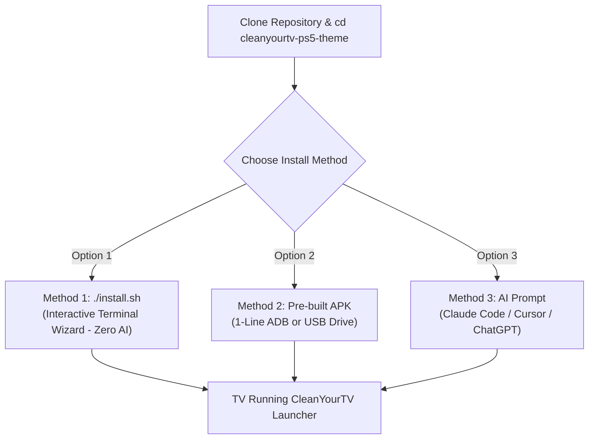

<p align="center">
  <a href="https://cleanyour.tv"></a>
</p>

# CleanYourTV — Apple TV 4K / PS5 Edition
*Customized by Ilham Asyari with cinematic Ken Burns wallpapers, ambient photo screensaver, interactive installer, and stats.*

---

## 📺 Prerequisites: Enable Debugging on Your TV

Before installing, make sure your computer and your TV are on the **same Wi-Fi network**:

1. On your TV remote, open **Settings ⚙️** → **Device Preferences** (or **System**) → **About**.
2. Scroll to **Android TV OS build** (or **Build**) and click the **OK** button **7 times** until it says *"You are now a developer!"*.
3. Go back one screen → open **Developer options**.
4. Turn **ON** both **USB debugging** and **Network debugging** (or **Wireless debugging**). Keep the TV screen turned ON.
5. Find your TV's IP address: Go to **Settings ⚙️** → **Network & Internet** → click your connected Wi-Fi (e.g. `192.168.1.150`).

---

## 🚀 3 Ways to Install & Customize (Step-by-Step)

Choose whichever method fits your setup:



---

### ⚡ Method 1: Interactive Terminal Wizard (`./install.sh`) — *Zero AI Required*
*Recommended for most users. A guided wizard in your terminal that asks you questions and handles the rest.*

#### Step 1: Clone the repository
Open your Terminal (macOS/Linux) or Git Bash / Command Prompt (Windows):
```bash
git clone https://github.com/ilhamasy/cleanyourtv-ps5-theme.git
```

#### Step 2: Navigate to the project directory
```bash
cd cleanyourtv-ps5-theme
```

#### Step 3 (Optional): Add your custom wallpapers
If you want custom show wallpapers for your dock apps:
- Put your 1920×1080 `.jpg` files into `launcher/app/src/main/res/drawable-nodpi/` (named `wallpaper_netflix.jpg`, `wallpaper_youtube.jpg`, etc.).
- When the APK compiles, these wallpapers are **baked directly inside the APK**.

#### Step 4 (Optional): Add screensaver photos
- Drop personal photos (Apple `.HEIC`, `.JPG`, `.PNG`) into the `screensaver/` folder.
- *(Note: `screensaver/` is gitignored so your personal photos will never be tracked or uploaded to GitHub).*

#### Step 5: Run the installer
```bash
./install.sh
```
The wizard will interactively guide you:
1. Detects your Android TV or prompts: `Enter your TV IP address (e.g. 192.168.1.150): `
2. **Interactive Dock Apps Setup**: Choose which apps you want on the dock from the curated list of 7 (e.g. type `1 3 4 5 7` to select 5 apps, or press Enter for all 7). The launcher automatically adjusts the columns and layout to match your selection!
3. Asks whether to use the pre-compiled `app-deblouting-ps5.apk` or recompile from source.
4. Automatically prompts: `Sync screensaver photos to TV (/sdcard/Screensaver/)? (Y/n)` if photos are detected in `screensaver/`. If you leave it empty or don't add photos, CleanYourTV seamlessly falls back to its default screensaver (drifting clock & ambient color-shifting glow).
5. Grants usage stats permissions and starts CleanYourTV immediately on your screen!

#### Step 6: Rollback (if ever needed)
To return to your factory stock launcher at any time:
```bash
./uninstall.sh
```

---

### 📦 Method 2: Sideload / Pre-built APK (`app-deblouting-ps5.apk`) — *Zero Setup Required*
*Fastest method if you already have ADB or want to install via USB flash drive without compiling anything.*

#### Option A: Via ADB Command Prompt (1-Liner)
1. **Clone the repository**:
   ```bash
   git clone https://github.com/ilhamasy/cleanyourtv-ps5-theme.git
   cd cleanyourtv-ps5-theme
   ```
2. **Connect to your TV**:
   ```bash
   adb connect <YOUR_TV_IP>:5555
   ```
   *(Accept the "Always allow from this computer" prompt on your TV screen if it appears).*
3. **Install the APK**:
   ```bash
   adb install -r launcher/app/build/outputs/apk/debug/app-deblouting-ps5.apk
   ```
   *(or use the root shortcut `adb install -r app-deblouting-ps5.apk`)*
4. **Grant permissions & start**:
   ```bash
   adb shell appops set com.gathin.tvhome GET_USAGE_STATS allow
   adb shell am start -n com.gathin.tvhome/.MainActivity
   ```
5. **(Optional) Sync Screensaver**:
   ```bash
   ./tools/sync-screensaver.sh
   ```

#### Option B: Via USB Flash Drive (Zero PC Required)
1. Download or copy `app-deblouting-ps5.apk` onto a USB flash drive.
2. Plug the USB flash drive into your TV's USB port.
3. On your TV, open any file manager (e.g., **X-plore File Manager**, **FX File Explorer**) or the **Downloader** app.
4. Select `app-deblouting-ps5.apk` and click **Install**.
5. Press the **HOME** button on your remote and choose CleanYourTV!

---

### 🤖 Method 3: Single AI Prompt Customization — *For AI Coding Assistants*
*Best if you want an AI assistant (Claude Code, Antigravity, Cursor, Codex, or ChatGPT) to automatically discover your installed TV apps and customize everything for you in one prompt.*

#### Step 1: Clone the repository & enter directory
```bash
git clone https://github.com/ilhamasy/cleanyourtv-ps5-theme.git
cd cleanyourtv-ps5-theme
```

#### Step 2: (Optional) Add your assets
- Drop any custom 1080p backdrops into `wallpapers/`.
- Drop any personal family photos into `screensaver/`.

#### Step 3: Launch your AI assistant in this directory
Open Claude Code, Antigravity, or Cursor terminal in the `cleanyourtv-ps5-theme` directory.

#### Step 4: Copy and paste this single prompt:
```markdown
I want to replicate and customize the CleanYourTV Apple TV 4K / PS5 style launcher on my Android TV.

Before making changes, please ask me:
1. "Which apps would you like pinned to your bottom dock, in order? (e.g., YouTube, Netflix, Disney+, Prime Video, Vidio, Apple TV, HBO Max, Plex, Spotify, etc.)"
2. "Do you have custom full-screen wallpapers for these apps (saved in wallpapers/), or would you like matching cinematic key art wallpapers mapped?"
3. "Would you like pure single-page mode (dock + top action buttons only) or keep the top tabs (Home & App list)?"

Once I provide my list of apps:
1. Connect to the TV over ADB (port 5555) and verify installed packages (`pm list packages`).
2. Update `launcher/app/src/main/res/values/config.xml`:
   - Set `<string-array name="dock_apps">` with my chosen apps in order.
   - Set `<integer name="columns">` to match the number of dock apps.
3. Configure the visual assets:
   - Map 1080p backdrops in `launcher/app/src/main/res/drawable-nodpi/wallpaper_<app>.jpg` with hardware-accelerated Ken Burns zoom & drift.
   - Keep top and left gradient scrim shadows for contrast.
4. If photos exist in `screensaver/`, run `tools/sync-screensaver.py` to optimize and sync them to `/sdcard/Screensaver/`.
5. Build `app-deblouting-ps5.apk`, install over ADB, grant `GET_USAGE_STATS` permission, and launch `com.gathin.tvhome/.MainActivity`.
6. Take a screenshot from the TV (`screencap -p`) and pull it to verify that everything looks pixel-perfect.
```

#### Step 5: Rollback (if ever needed)
Simply prompt the AI:
> *"Please uninstall CleanYourTV from my TV, re-enable my stock launcher, and reset local code changes."*

---

## 🛠️ In-Depth Tutorials & Customization Guide

### 1. 🖼️ How to Add & Change Custom Wallpapers
Each dock app displays a full-bleed 1080p cinematic backdrop that cross-fades and slowly zooms/drifts (Ken Burns effect) when focused:

#### Step 1: Prepare 1080p Backdrops
- Choose 1920×1080 JPEG images for your streaming apps (e.g. key art from Netflix, YouTube, Prime Video, etc.).

#### Step 2: Naming Rules on Disk (Android Resource Rules)
Place the image in `launcher/app/src/main/res/drawable-nodpi/wallpaper_<name>.jpg`:
- ⚠️ **Must be strictly lowercase**: Use only `a-z`, `0-9`, and underscore `_`.
- ❌ **NO dashes (`-`)**: e.g., `wallpaper-prime.jpg` is **invalid** in Android.
- ❌ **NO capital letters**: e.g., `PrimeVideo.jpg` is **invalid** in Android.
- ✅ **Valid Examples**:
  - `wallpaper_prime.jpg`
  - `wallpaper_netflix.jpg`
  - `wallpaper_spotify.jpg`

*(Also keep a copy in `wallpapers/<name>.jpg` for quick reference).*

> [!NOTE]
> **What is the root `/wallpapers` folder for?**
> - **`res/drawable-nodpi/`**: This is where the Android build system compiles images directly into the APK (`app-deblouting-ps5.apk`).
> - **`/wallpapers/` (repo root)**: This is your developer asset gallery & staging archive. It keeps your high-resolution original artwork safe outside Gradle's build tree, allowing you to preview, organize, and back up backdrops without touching internal Android directory structures.

#### Step 3: Java Mapping Syntax in `MainActivity.java`
In [`launcher/app/src/main/java/com/gathin/tvhome/MainActivity.java`](launcher/app/src/main/java/com/gathin/tvhome/MainActivity.java), find the `DOCK_WALLPAPERS` block around line 270:

```java
DOCK_WALLPAPERS.put("<package_name>", R.drawable.<filename_without_extension>);
```

##### ⚠️ Important Syntax Rules:
1. **NO file extension**: Never write `.jpg` or `.png` in Java code! Android compiles files into integer IDs.
   - ✅ Correct: `R.drawable.wallpaper_prime`
   - ❌ Incorrect: `R.drawable.wallpaper_prime.jpg` *(Causes build error)*
2. **Capital `R`**: Must be uppercase `R.drawable`, never lowercase `r.drawable`.
3. **Exact Package Name**: Must match the TV app package name.

##### 📋 Real Code Examples:
```java
// Prime Video:
DOCK_WALLPAPERS.put("com.amazon.amazonvideo.livingroom", R.drawable.wallpaper_prime);

// Netflix:
DOCK_WALLPAPERS.put("com.netflix.ninja", R.drawable.wallpaper_netflix);

// Spotify:
DOCK_WALLPAPERS.put("com.spotify.tv.android", R.drawable.wallpaper_spotify);
```

> [!TIP]
> **Automatic Dynamic Detection**: The launcher also has an automated dynamic fallback: If you name your file `wallpaper_<appname>.jpg` (e.g., `wallpaper_spotify.jpg` for `com.spotify.tv.android`), the launcher will automatically detect and link it even if you didn't manually edit `MainActivity.java`!

#### Step 4: Compile into APK
When you build with `./install.sh` or `./gradlew assembleDebug`, all wallpapers are **baked directly inside `app-deblouting-ps5.apk`**. No internet connection or external storage is required on the TV to display wallpapers!

---

### 2. 📸 How to Add Screensaver Photos
The screensaver automatically adapts depending on whether you add personal photos:
- **With Personal Photos**: A smooth, non-burning photo slideshow with original aspect ratio preservation (portrait photos get subtle blurred ambient borders, landscape photos fit full screen).
- **Without Photos (Default Screensaver Fallback)**: Automatically displays CleanYourTV's signature screensaver — a clean floating clock and date drifting across a pitch-black screen over a color-shifting radial ambient glow.

1. **Place your photos (Optional)**: Drop any personal photos (Apple `.HEIC`, `.JPG`, `.PNG`, `.WEBP`) into the `screensaver/` folder.
   > [!NOTE]
   > **Privacy Guarantee**: The `screensaver/` folder is tracked with a guide, but photo files inside are strictly in `.gitignore`. Your personal photos will **never** be committed to Git or uploaded to GitHub.
2. **Sync to TV**:
   - **Automatic**: When running `./install.sh`, it will detect any photos in `screensaver/` and ask:
     ```
     Detected personal photos in screensaver/ folder. Sync screensaver photos to TV (/sdcard/Screensaver/)? (Y/n)
     ```
     *(If no photos are found, it skips this step and keeps CleanYourTV's default screensaver active).*
   - **Standalone Script**: You can also run `./tools/sync-screensaver.sh` anytime. It converts HEIC to baseline JPEG, optimizes dimensions to 1080p (reducing size by ~85% to prevent TV RAM crashes), and uploads them to `/sdcard/Screensaver/`.
   - **USB Method (Zero PC)**: You can copy photos to a USB flash drive and paste them into `/sdcard/Screensaver/` on your TV using any TV file manager (e.g. X-plore).

---

### 3. 🔊 Authentic PS5 UI Sound Effects (Beeps & Clicks)
The launcher includes an ultra-low-latency `SoundPool` engine playing official PlayStation 5 console UI sound effects:

| Action | Audio File | Trigger |
|---|---|---|
| **D-Pad Navigation** | [`sounds/navigation.wav`](sounds/navigation.wav) | Pressing **UP**, **DOWN**, **LEFT**, **RIGHT** on TV remote |
| **Enter / OK** | [`sounds/enter.wav`](sounds/enter.wav) | Pressing **OK / ENTER** to launch an app, click a tab, or open a menu |
| **Back / Cancel** | [`sounds/back.wav`](sounds/back.wav) | Pressing **BACK / ESC** on remote, dismissing menus, or returning to Home |

#### 📂 Where are sound files stored?
- **Root archive**: [`sounds/`](sounds/) holds the master copies of `navigation.wav`, `enter.wav`, and `back.wav`.
- **Compiled APK resources**: [`launcher/app/src/main/res/raw/`](launcher/app/src/main/res/raw/) (`navigation.wav`, `enter.wav`, `back.wav`) are compiled directly into `app-deblouting-ps5.apk` as 16-bit PCM WAV for 0ms latency audio playback on any TV.
- **Audio engine**: Managed via [`SoundManager.java`](launcher/app/src/main/java/com/gathin/tvhome/SoundManager.java) with stream pooling, rapid-repeat throttling, and debounce protection.

---

### 4. 📱 Handling "Outside" Apps & Missing Default Apps

#### What if a default dock app is NOT installed on the TV?
*(e.g. HBO Max is listed in the dock, but the TV doesn't have it installed)*
- **100% Safe & Zero Crashes**: The launcher checks Android's `PackageManager` first. Any uninstalled app is simply skipped.
- **Auto-Fill Option**: If `<bool name="fill_dock">true</bool>` is enabled in [config.xml](launcher/app/src/main/res/values/config.xml), any empty slot is automatically filled by other installed apps so there is never an awkward gap.
- **Play Store Detection**: If the user installs the missing app later from Google Play Store, the launcher detects it and places it on the dock automatically.

#### How to access apps outside the dock?
*(e.g. Spotify, Kodi, VLC, Plex, or games not pinned to the dock)*
- **Option A (Add to Dock)**: Edit `dock_apps` and `columns` in [config.xml](launcher/app/src/main/res/values/config.xml). The dock supports any number of apps.
- **Option B (App Grid Below Dock)**: Set `<integer name="rows_below_dock">1</integer>` (or 2) in [config.xml](launcher/app/src/main/res/values/config.xml). Pressing **DOWN** on the remote scrolls into a grid of all your other apps.
- **Option C (Top "App" Tab)**: Set `topTabs` visibility to `visible` in [activity_main.xml](launcher/app/src/main/res/layout/activity_main.xml) to get an Apple TV-style top tab bar with a dedicated full-screen App Library.
- **Option D (Top Settings Icon)**: Click the **Settings ⚙️** icon on the top bar -> **Apps** -> **See all apps** to launch any installed app.

---

### 4. 🔄 How to Rollback / Restore Stock Launcher
Rolling back is completely safe and takes less than 15 seconds:

- **From TV (Zero PC Required)**:
  1. Go to TV **Settings ⚙️** → **Apps** → **See all apps**.
  2. Click **CleanYourTV** (or `com.gathin.tvhome`) → **Uninstall**.
  3. Press the **HOME** button on your remote. Your TV instantly reverts to its factory default stock launcher.
- **Via 1-Click Script**: Run `./uninstall.sh` in terminal.
- **Via ADB Command**: `adb uninstall com.gathin.tvhome`

---

## 📸 Live Screen Captures from TV

| | |
|---|---|
|  |  |
| *HBO Max (The Last of Us)* | *Netflix (Stranger Things)* |
|  |  |
| *Disney+ (Avengers)* | *Prime Video (The Boys)* |

## Supported TVs

Anything running **Android TV** or **Google TV**. Samsung (Tizen) and LG (webOS) run different
systems; see [SHOWCASE.md](SHOWCASE.md) for a webOS port, and
[docs/devices/samsung-tizen.md](docs/devices/samsung-tizen.md) for what a 2021 Samsung set answers
over Wi-Fi (no ADB, so no `pm disable-user`) if you are weighing a Tizen port. **Fire TV** takes the
debloat half only, since Fire OS will not hand Home to a third-party launcher - and on the 2015 Fire
TV Box (Fire OS 5) even that half fails: every `pm` route is refused, so nothing can be disabled
there at all. A few China-market TCL
sets refuse to install any launcher at all; their lists say so in the header.
